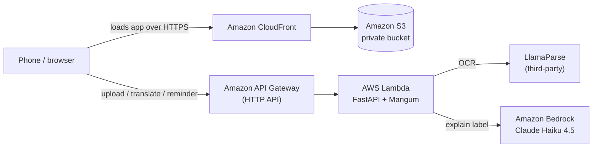

# UbatJelas

**Photo in, plain language out.** UbatJelas explains printed pharmacy labels to elderly Malaysians and their caregivers, in English, Bahasa Malaysia, Tamil or Mandarin.

Built by **Team MindSparks (Nilai University)** for the AWS CendekiAwan National Showcase.

> A label that says `1 tab BD PRN` is explained once at the pharmacy counter. At home, alone, it is just shorthand. UbatJelas turns it into plain words and sets reminders.

---

## Features

- **Snap, don't type.** Choose a language, upload a photo or PDF of a label. No account, no prompt.
- **Plain-language explanation.** Decodes pharmacy shorthand (BD, TDS, PC, etc.) and shows it beside the exact text read from the label.
- **Four languages.** English, Bahasa Malaysia, Tamil and Mandarin, for both the interface and the explanation.
- **Label only, by design.** The model is instructed to explain only what is printed. Requests for advice beyond the label are redirected to a pharmacist or doctor.
- **Stops on unreadable photos.** If too little text is extracted, the app halts and asks for a clearer photo instead of guessing.
- **Editable reminders.** Dose times are proposed from the frequency and the meal relation (before or after food), and can be edited or switched off.

> UbatJelas is a label-literacy aid, not a medical device. Always confirm with your doctor or pharmacist.

---

## Architecture



| Layer | Service |
|---|---|
| Frontend hosting | Amazon S3 (private) behind Amazon CloudFront (HTTPS) |
| API | Amazon API Gateway (HTTP API) |
| Backend | AWS Lambda, Python 3.12, FastAPI via Mangum |
| OCR | LlamaParse (third-party, not AWS) |
| Language model | Amazon Bedrock, Claude Haiku 4.5 |
| Infrastructure as code | AWS SAM (CloudFormation) |
| CI/CD | GitHub Actions |

There is no database. The app stores nothing between requests.

---

## How it works

1. **Upload.** The browser sends the image or PDF to `POST /upload`. PDFs are rasterized (first page only) with PyMuPDF.
2. **OCR.** The image is sent to LlamaParse. If fewer than `MIN_CHARS_THRESHOLD` characters come back, the flow stops with a "try a clearer photo" message.
3. **Explain.** The extracted text goes to `POST /translate`, which calls Claude Haiku 4.5 on Bedrock with a constrained system prompt and returns structured JSON (explanation, medicine name, frequency code, meal relation, duration).
4. **Remind.** `POST /reminder` converts the frequency and meal relation into proposed reminder times.

### API

| Method | Path | Purpose |
|---|---|---|
| `GET` | `/health` | Health check |
| `POST` | `/upload` | Multipart: `file` (JPEG, PNG or PDF), `session_language`. Returns the OCR text |
| `POST` | `/translate` | JSON: `raw_text`, `session_language`. Returns the plain-language explanation |
| `POST` | `/reminder` | JSON: `frequency_code`, `meal_relation`, `manual_times`, `session_language`. Returns proposed times |

`session_language` is one of `en`, `ms`, `ta`, `zh`.

### Shorthand the app recognizes

| Code | Meaning | Code | Meaning |
|---|---|---|---|
| OD | once a day | AC | before food |
| OM | every morning | PC | after food |
| ON | every night | PO | by mouth |
| BD | twice a day | tab | tablet |
| TDS | three times a day | maks Nx/hari | maximum N times a day |
| QID | four times a day | PRN | only when needed |

Reminders are generated for OD, OM, ON, BD, TDS and QID. `PRN` has no fixed schedule, so the app offers manual reminders. A term the model cannot map confidently is flagged for the user to confirm with a pharmacist.

---

## Repository structure

```
.
├── .github/workflows/deploy.yml   # GitHub Actions: build, deploy, upload frontend
├── backend/lambda/
│   ├── lambda_handler.py          # Lambda entry point (Mangum)
│   ├── requirements.txt
│   └── app/
│       ├── main.py                # FastAPI routes
│       ├── llamaparse_service.py  # OCR
│       ├── bedrock_service.py     # Claude on Bedrock
│       ├── i18n.py                # UI strings and the system prompt
│       ├── reminder_logic.py      # Reminder rules
│       └── models.py              # Request/response schemas
├── frontend/index.html            # Single-page static frontend
└── infra/template.yaml            # SAM template (Lambda, API, S3, CloudFront)
```

---

## Configuration

Lambda environment variables (set in `infra/template.yaml`):

| Variable | Default | Purpose |
|---|---|---|
| `BEDROCK_MODEL_ID` | `global.anthropic.claude-haiku-4-5-20251001-v1:0` | Bedrock model or inference profile ID |
| `LLAMA_CLOUD_API_KEY` | (required) | LlamaCloud key for OCR, passed as a NoEcho stack parameter |
| `MAX_FILE_SIZE_MB` | `4` | Upload size limit |
| `MIN_CHARS_THRESHOLD` | `20` | Minimum extracted characters for a readable label |
| `CORS_ALLOW_ORIGINS` | `*` | Allowed origins |
| `LLAMA_INDEX_CACHE_DIR` | `/tmp/llama_index` | Writable cache path on Lambda |

---

## Run locally

Prerequisites: Python 3.12, AWS credentials with Bedrock access, and a LlamaCloud API key.

```bash
cd backend/lambda
python -m venv .venv && source .venv/bin/activate   # Windows: .venv\Scripts\activate
pip install -r requirements.txt

export LLAMA_CLOUD_API_KEY="your-key"
export AWS_REGION="ap-southeast-1"
export MAX_FILE_SIZE_MB="4"
uvicorn app.main:app --reload
```

Then open `frontend/index.html` with `API_URL` set to `http://localhost:8000`. Do not commit that change. The deploy workflow replaces the `__API_URL_PLACEHOLDER__` value with the real API URL.

`python backend/lambda/test_bedrock.py` checks which Bedrock model IDs work in your account and region.

---

## Deploy

### With GitHub Actions

1. In the repo, go to **Settings → Secrets and variables → Actions** and add:
   - `AWS_ACCESS_KEY_ID`
   - `AWS_SECRET_ACCESS_KEY`
   - `AWS_SESSION_TOKEN` (required for temporary credentials)
   - `LLAMA_CLOUD_API_KEY`
2. Go to **Actions → Deploy UbatJelas → Run workflow**.
3. When it finishes, the **Print URLs** step shows the API URL and the HTTPS frontend URL.

The workflow builds with SAM, deploys the `ubatjelas` stack to `ap-southeast-1`, injects the API URL into `index.html`, uploads it to S3 and invalidates the CloudFront cache. The first CloudFront deploy can take 5 to 15 minutes. Temporary credentials expire, so refresh the secrets before each run.

### Manually with SAM

```bash
sam build --template infra/template.yaml --base-dir .
sam deploy --stack-name ubatjelas --resolve-s3 \
  --capabilities CAPABILITY_IAM --region ap-southeast-1 \
  --parameter-overrides LlamaCloudApiKey=YOUR_KEY
```

---

## Limitations

- **Upload size is 4 MB.** API Gateway base64-encodes uploads, so larger files exceed Lambda's 6 MB request limit.
- **Readable-photo check is a heuristic.** LlamaParse gives no confidence score, so the app stops when fewer than 20 characters are extracted. A bad photo that still yields garbled text can pass.
- **PDFs use the first page only.**
- **Third-party OCR.** Label images are sent to LlamaParse. Review its data policy before any real-world use.
- **Shorthand coverage is limited** to the list above. Unknown terms are flagged, not guessed.

---

## Roadmap

- A large, growing short-form database so far more pharmacy abbreviations are decoded
- In-app guide and multi-file upload
- Pilot at government health clinics, with a QR code at the pharmacy counter and no system integration

---

## Team

**Team MindSparks**, Nilai University. Built for the AWS CendekiAwan National Showcase.
